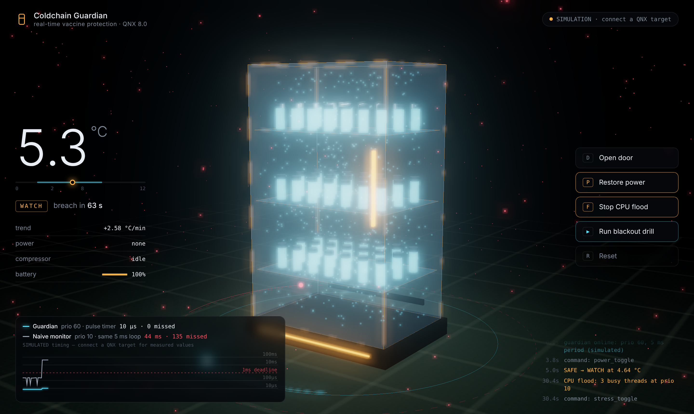

# Coldchain Guardian

**A real-time vaccine cold-chain guardian on QNX 8.0. It predicts a temperature breach and acts before it happens, even when the CPU is flooded.**

Vaccines must stay between **2 °C and 8 °C**. In much of the world, including where I live in northern Nigeria, clinic fridges ride out grid failures on generators and batteries in 32 °C+ heat. When a monitor reacts late, a whole tray of vials quietly loses potency and nobody finds out until it's too late.

Coldchain Guardian is the safety brain for that fridge:

- **It predicts.** Every 100 ms it fits a trend to the last 4 s of readings and projects the seconds left until the vials leave the safe band.
- **It acts first.** When the grid drops, it engages battery cooling about 60 s *before* the projected breach, not after the alarm. It also sounds the door buzzer and logs every decision.
- **It keeps running when the system is overloaded.** The control loop is a priority-60 thread woken by a QNX kernel timer pulse every 5 ms. A second, identical loop at priority 10 (how most IoT firmware runs) sits beside it. When you press **Flood CPU**, ordinary work at priority 11 takes every core: the naive loop gets no CPU time at all, and the guardian carries on. The dashboard draws both from measured data, so you can watch that difference live.

**Live preview (simulation mode):** https://coldchain-guardian.vercel.app


---

## How it uses QNX 8.0

| QNX technology | Where | Why it matters here |
|---|---|---|
| **Resource manager** (`resmgr_attach`, `iofunc_*`, `dispatch_*`) | `src/resmgr.c` · `cc_resmgr_start()` | The sensor is a real device node, `/dev/coldchain`. `cat` it, or `echo power_off >` it from the QNX shell. |
| **Custom `devctl()`** `DCMD_CC_GET_SAMPLE` | `src/resmgr.c` · `io_devctl()`, `cc_sensor_read()` | The guardian reads the sensor with one synchronous `MsgSend()`, not shared memory. |
| **Priority inheritance across message passing** | `src/resmgr.c` (header comment) | The driver thread (prio 50) runs the guardian's request at prio 60, so nothing the guardian outranks can starve its sensor read. |
| **Kernel timer → pulse** (`timer_create` + `SIGEV_PULSE_INIT` + `MsgReceivePulse`) | `src/guardian.c` · `cc_guardian_thread()` | A deterministic 5 ms tick with no signals and no polling. |
| **Explicit real-time scheduling** (`SCHED_FIFO`/`SCHED_RR`, prio 60/50/20/15/10) | `src/main.c`, `src/platform.c` · `cc_thread()` | The guardian outranks everything else; the CPU flood runs at prio 11, one level above the naive loop. |
| **`ClockCycles()` + system page `qtime->cycles_per_sec`** | `src/platform.c` | Cycle-accurate measurement of the loop's own jitter and execution time. |
| **Priority-inheritance mutex** | `src/world.c` · `cc_world_init()` | A prio-15 web thread holding the state lock is boosted, never left blocking the guardian. |
| **`trace_logf()` user events + `tracelogger` / `traceprinter`** | `src/platform.c` · `cc_trace()`, `tools/trace.sh` | Every state change, action and deadline miss sits in the kernel event log next to every context switch. That's independent proof of the timing. |
| **`mlockall()`** | `src/main.c` | No page faults in the control path. |

Actuation goes through the driver too: the guardian's `write(fd, "backup_on")` is itself a message to `/dev/coldchain`.

---

## Measured results

Measured on QNX 8.0.0 x86_64 in a VirtualBox 7.2 VM (2 vCPUs) on a Windows 11 laptop (Intel i5-8350U), 12 Nov 2026.

| | Guardian (prio 60) | Naive monitor (prio 10) |
|---|---|---|
| **During a 16.5 s CPU flood** (3 busy threads at prio 11) | kept ticking throughout, worst gap 15 ms | **did not run once: starved for 16.5 s** |
| Idle, 16,333 ticks | 74% within 1 ms, 98% within 5 ms | about the same (nothing competes with it) |

**What these numbers do and don't show.** The flood result is the scheduler doing its job: priority alone decides who runs, and it holds under full load. The idle jitter is *not* QNX's real-time performance. QNX's clock is set to a 1 ms tick (`pidin syspage=qtime`), but a desktop VM delivers those ticks late whenever Windows pauses the virtual CPUs, so both loops see the same millisecond-level noise, with occasional spikes above 100 ms. Absolute jitter needs real hardware (for example a Raspberry Pi 5 with `make qnx-arm`), which I have not measured.

---

## Architecture

```
                       QNX 8.0 (x86_64 VM or Raspberry Pi 5)
 ┌──────────────────────────────────────────────────────────────────────────┐
 │ coldchaind                                                               │
 │                                                                          │
 │  kernel timer ──pulse every 5 ms──▶ GUARDIAN  prio 60 FIFO               │
 │                                      │  devctl(DCMD_CC_GET_SAMPLE)       │
 │                                      │  write("backup_on")               │
 │                                      ▼                                   │
 │                              /dev/coldchain  resource manager, prio 50   │
 │                              (runs at the client's priority)             │
 │                                      │                                   │
 │  PLANT prio 20  ── thermal model of the fridge, 10 ms ──┘                │
 │  HTTP  prio 15  ── /api/state · /api/stream (SSE) · /api/cmd · static UI │
 │  NAIVE prio 10  ── same 5 ms loop, no privileges (the control group)     │
 │  FLOOD prio 11  ── N+1 busy threads, toggled from the UI, 30 s max       │
 └──────────────────────────────────────────────────────────────────────────┘
                 │ HTTP + Server-Sent Events, 10 Hz
                 ▼
     Browser: Three.js scene · readout · measured-jitter chart
```

The thermal model is the stand-in for real hardware; on a Pi 5 it would be swapped for a DS18B20 behind the same `/dev/coldchain` interface. Its constants are tuned for demo time: a grid failure takes about 80 s to push the vials past 8 °C.

---

## Build and run

**QNX version:** QNX SDP 8.0 (QNX Everywhere, non-commercial licence)
**Target:** x86_64 QNX 8.0 VM built with `mkqnximage` (VMware or VirtualBox on Windows, QEMU on Ubuntu). A Raspberry Pi 5 works with `make qnx-arm`.
**Toolchain:** `qcc -Vgcc_ntox86_64` from SDP 8.0

### 1. Build the target image

```bash
# Linux:   source ~/qnx800/qnxsdp-env.sh
# Windows: run qnxsdp-env.bat from your SDP folder, in a cmd window
mkdir qnxvm && cd qnxvm
mkqnximage --type=qemu --arch=x86_64 --run    # Ubuntu host
mkqnximage --type=vbox --arch=x86_64 --run    # Windows host (or --type=vmware)
mkqnximage --getip                            # prints the target IP
```

The default users are `root`/`root` and `qnxuser`/`qnxuser`.

### 2. Build and deploy coldchaind

```bash
make qnx                               # → build/x86_64/coldchaind
TARGET=192.168.56.101 ./tools/deploy.sh

:: Windows host (cmd): compiles, copies and runs in one step
deploy.bat 192.168.56.101
```

Or by hand:

```bash
qcc -Vgcc_ntox86_64 -O2 -std=gnu11 -o coldchaind src/*.c -lsocket -lm
ssh root@<ip> mkdir -p /data/coldchain
scp -r coldchaind web root@<ip>:/data/coldchain/
```

### 3. Run it (as root: the resource manager attaches to `/dev`)

```sh
ssh root@<ip>
/data/coldchain/coldchaind --web /data/coldchain/web
```

Open **`http://<ip>:8080`**. The target serves the dashboard itself, and the pill in the top-right shows `LIVE · QNX 8.0.0 x86_64`.

### 4. Poke the driver from the QNX shell

```sh
cat /dev/coldchain                  # temp=4.61 door=0 power=1 comp=0 backup=0 batt=100 level=0
echo power_off > /dev/coldchain     # the 3D fridge goes dark; watch the guardian respond
echo power_on  > /dev/coldchain
pidin -p coldchaind                 # thread priorities: 60, 50, 20, 15, 10
```

### 5. Capture kernel-level proof

```sh
sh /data/coldchain/trace.sh         # tracelogger + traceprinter, guardian events extracted
```

### Developing without a target

```bash
make linux && ./build/linux/coldchaind --web web     # http://localhost:8080
```

The Linux build compiles the same sources with POSIX fallbacks. It has no real-time guarantees, which is the point: run the CPU flood on both and compare.

To run the dashboard alone, serve the `web/` folder with any static server (`npx serve web` or `python -m http.server -d web`). With no daemon reachable it falls back to a clearly labelled in-browser simulation, which is also what the hosted Vercel preview runs.

---

## Dashboard

- **Drag** to orbit. **Click the door** to open it. Keys: **D** door, **P** power, **F** flood CPU, **R** reset, **Space** blackout drill.
- **Inner cyan orbit:** the guardian. The orb moves by the *measured* tick count (200 ticks = one revolution).
- **Outer grey orbit:** the naive prio-10 monitor. When it is starved, it visibly stalls and turns red.
- **Proof strip:** the worst wake-up jitter per second for both loops on a log scale, with the 1 ms deadline marked.
- **Blackout drill:** a 90-second scripted scenario (grid failure → predictive battery cooling → CPU flood → open door → recovery) with captions.

Built with Three.js r170, vendored in `web/vendor`. Nothing is loaded from a CDN, so a clinic target with no internet still serves the full UI.

## API

| Method | Path | |
|---|---|---|
| GET | `/api/state` | one JSON snapshot |
| GET | `/api/stream` | Server-Sent Events, 10 Hz |
| POST | `/api/cmd?do=<cmd>` | `door_open` `door_close` `power_off` `power_on` `fault_on` `fault_off` `stress_on` `stress_off` `reset` `reset_stats` |

## Repository layout

```
src/        coldchaind (C11): resmgr.c guardian.c plant.c world.c http.c stress.c platform.c main.c
web/        dashboard: index.html app.js scene.js sim.js style.css vendor/three
tools/      deploy.sh (Linux/macOS host) · trace.sh (target)
deploy.bat  build + copy + run from a Windows host
docs/       CODELAB.md (tutorial) · SUBMISSION.md
```

## Licence

Apache-2.0. Three.js is MIT-licensed (`web/vendor/three/LICENSE`).
